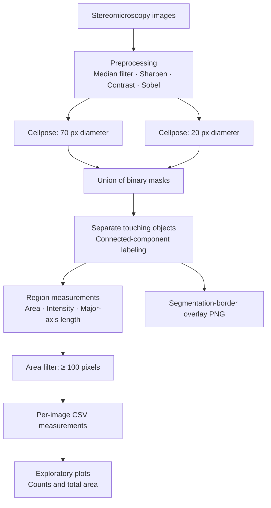

# Automated Organoid Segmentation and Quantification

### A Python image-analysis workflow supporting organoid formation efficiency (OFE) studies from challenging stereomicroscopy images

**Keywords:** Bioimage analysis · Organoids · Stereomicroscopy · Cellpose · Python · Segmentation · Morphometry · Batch processing

## Overview

This project implements a Python/Jupyter Notebook workflow to detect, segment, and quantitatively characterize organoid-like objects in stereomicroscopy images. It was developed to support **organoid formation efficiency (OFE)** studies in which reliable object detection is difficult because images have limited resolution, variable background appearance, and considerable variation in object size and morphology.

The workflow combines classical image processing with **Cellpose segmentation at two object scales**, followed by mask refinement, connected-component labeling, and per-object feature extraction. It processes image folders recursively and produces **CSV measurements and segmentation overlays** for inspection and downstream comparison between experimental conditions.

> **Scope:** The supplied notebook performs automated object detection, filtering, measurement, and exploratory plotting. It does **not** calculate OFE percentages from seeded-cell counts, validate detected objects against manual ground truth, or establish that each segmented object is biologically an organoid.

## Scientific motivation

Organoid formation efficiency is commonly assessed by relating the number of organoids formed to the number of cells initially seeded. Accurate counting is therefore an important part of the analysis. In stereomicroscopy images, however, low spatial resolution, heterogeneous illumination/backgrounds, variable organoid sizes and shapes, and touching objects can make manual or threshold-only segmentation unreliable or labor-intensive.

This project explores a reproducible, batch-oriented approach for extracting object counts and morphology measurements from such images, while retaining overlays that can be reviewed for segmentation quality.

## Workflow architecture



## Processing steps

### 1. Image loading and preprocessing

- Recursively discovers common image formats (`.tif`, `.tiff`, `.png`, `.jpg`, `.jpeg`, `.bmp`, including OME-TIFF suffixes).
- Uses the first channel of three-dimensional image arrays; two-dimensional images are processed directly.
- Converts input data to 8-bit for filtering.
- Applies a **median filter** using a disk of radius **3 pixels**.
- Sharpens with a 3 × 3 kernel and enhances contrast using `alpha = 2.0`, `beta = 0`.
- Applies a **Sobel edge filter** to prepare the segmentation input.

### 2. Multiscale Cellpose segmentation

The notebook initializes the **Cellpose `cyto` model on CPU** and evaluates the preprocessed image twice:

| Parameter | Pass 1 | Pass 2 |
|---|---:|---:|
| Expected diameter | 70 px | 20 px |
| `flow_threshold` | 0 | 0 |
| `cellprob_threshold` | -2 | -2 |

The two labeled outputs are converted into **binary foreground masks** and combined using a logical OR. This expands detection across different apparent object sizes, but it also discards the original instance identities before relabeling.

### 3. Mask refinement and object labeling

The combined mask is processed with `split_touching_objects` from `napari-segment-blobs-and-things-with-membranes`, then relabeled with `pyclesperanto_prototype` connected-component labeling. Object boundaries are extracted for visual quality control.

### 4. Morphometric feature extraction

For each labeled object, `skimage.measure.regionprops` extracts:

| Output column | Description |
|---|---|
| `area` | Object area in pixels |
| `max` | Maximum image intensity within the object |
| `min` | Minimum image intensity within the object |
| `mean` | Mean image intensity within the object |
| `major_axis` | Major-axis length in pixels |
| `type` | `Success` for area ≥ 100 pixels; otherwise `Ambiguous` |

Only objects labeled `Success` are included in the exported CSV. **`Success` denotes passage of a size threshold; it is not a validated biological classification.** Areas and lengths are in pixel units unless a separate calibration is applied.

### 5. Batch outputs and visualization

For each input image, the notebook saves:

- `<image_name>.csv` — per-object measurements after the area filter.
- `<image_name>_overlay.png` — original image with detected object boundaries drawn in red.

A separate notebook section loads the output CSVs to plot **retained object counts per image**. It also computes total retained area per image, although the original notebook's second plot mistakenly uses the count values instead of the total-area values (see **Known limitations**).

## Repository structure

```text
organoid-segmentation-ofe/
├── README.md
├── Jinia_organoids_v1_BATCH_03122025.ipynb
├── environment.yml                 # Add when available
└── examples/                       # Optional, approved non-sensitive examples
    ├── input/
    └── output/
```

The `environment.yml` and example images are **not included** in the supplied project materials; the entries above are suggestions for future repository organization.

## Software requirements

The notebook imports:

- Python and Jupyter Notebook
- NumPy, Pandas, Matplotlib
- OpenCV (`cv2`)
- scikit-image
- Cellpose
- `pyclesperanto_prototype`
- `napari-segment-blobs-and-things-with-membranes`

> Exact tested package versions are not recorded in the notebook. API compatibility may vary across releases, particularly for Cellpose and NumPy. For reproducibility, use the original working environment or create and test a version-pinned `environment.yml` before publishing installation claims.

## How to run

1. Install compatible dependencies in a Python environment and launch Jupyter.
2. Open `Jinia_organoids_v1_BATCH_03122025.ipynb`.
3. Change the notebook's hard-coded `MAIN_FOLDER` path (`/Volumes/ipf/public/Data/Jinia/`) to a local directory containing your microscopy images.
4. Run the imports and function-definition cells, followed by the batch-processing cell.
5. Review the generated `results/` folder, especially the segmentation overlays.
6. Update the separate `results_folder` path in the plotting cell and run the analysis plots.

**Important:** The notebook is provided as a record of the analysis workflow, not a tested plug-and-play package. It may need environment-specific adjustments before execution on another machine.

## OFE interpretation

When the experiment defines OFE using the initial number of seeded cells, the calculation is typically:

\[
\mathrm{OFE}(\%) = \frac{\text{Number of organoids formed}}{\text{Number of cells initially seeded}} \times 100
\]

The current notebook provides **candidate object counts**, not seeded-cell counts or a complete OFE calculation. Any OFE result requires appropriate experimental denominators and review of false positives, missed organoids, and the criteria used to define a formed organoid.

## Known limitations and considerations

- **Image quality:** Low resolution and variable background can produce missed detections or false positives.
- **Segmentation uncertainty:** Touching structures may not separate correctly; merging binary masks removes the original Cellpose instance labels.
- **Size threshold:** The 100-pixel cutoff is heuristic and may exclude small true organoids or retain artifacts.
- **Channel handling:** Multi-channel inputs use the first channel, which may not always be the desired one.
- **Intensity conversion:** Non-8-bit integer images are clipped to 0–255 rather than generally rescaled, potentially losing intensity information.
- **Error handling:** Cellpose exceptions are caught without logging their details and replaced with empty masks, which can conceal failed segmentations.
- **Output naming:** Images in different subfolders with the same filename stem may overwrite or skip one another because results are stored in one folder.
- **Plot correction:** The original *Total segment area per image* plot uses `segment_counts` rather than `total_area`. To correct it, change `plt.bar(file_names, segment_counts)` to `plt.bar(file_names, total_area)` in that plot.
- **Validation:** No quantitative comparison against manually annotated ground truth is included in the supplied notebook.

## Potential extensions

- Add image-specific quality-control flags and manual review of uncertain detections.
- Benchmark counts against expert annotations and report precision/recall or counting error.
- Record experimental metadata and seeded-cell counts for condition-level OFE calculations.
- Calibrate pixel dimensions to physical units where microscope metadata is available.
- Move configurable parameters and input/output paths into a settings file.
- Pin and test dependencies and add example data that can be shared publicly.

## Author and attribution

**Ivey Sebastian** — Scientific Computing Facility, Max Planck Institute of Molecular Cell Biology and Genetics (MPI-CBG), Dresden.

Notebook: **`Jinia_organoids_v1_BATCH_03122025.ipynb`**, version **v1.0beta (December 2025)**. The notebook identifies **Jinia Lilianty** as the intended collaborator/user of the analysis.

This repository documents a computational image-analysis workflow. Before making source images, experimental data, or unpublished findings public, confirm the relevant permissions and attribution requirements.

## Project status

**Research workflow / portfolio documentation.** The repository describes the uploaded notebook as implemented; it does not claim validated OFE measurements or benchmark performance that were not supplied.
